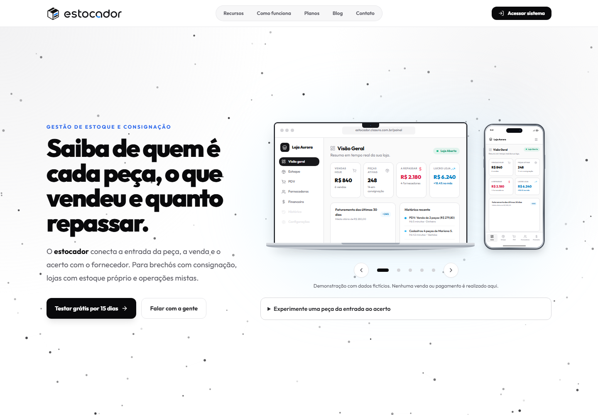
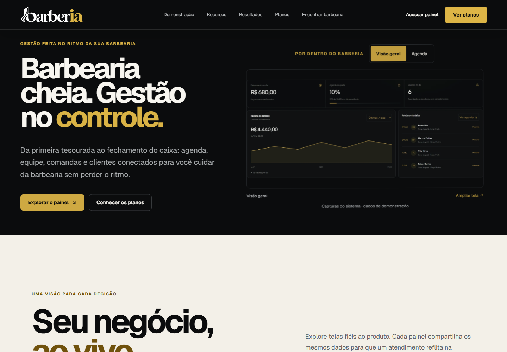
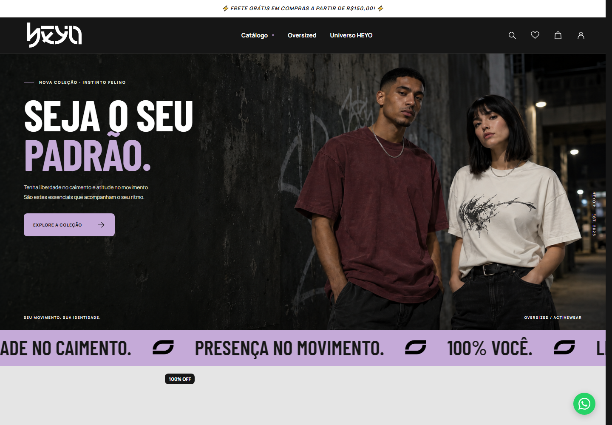
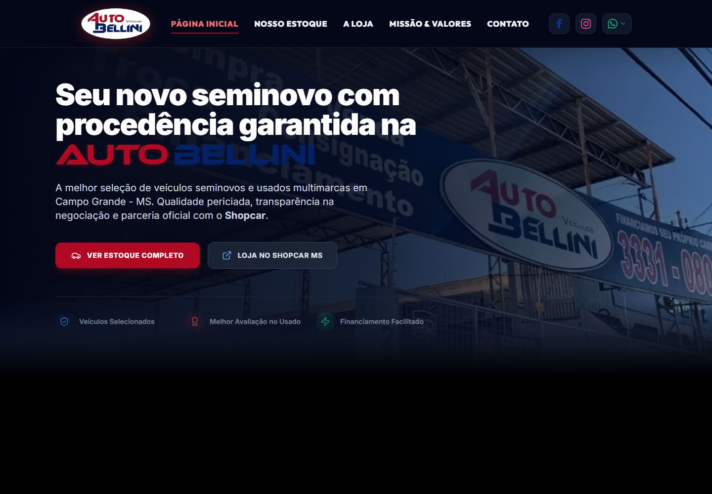
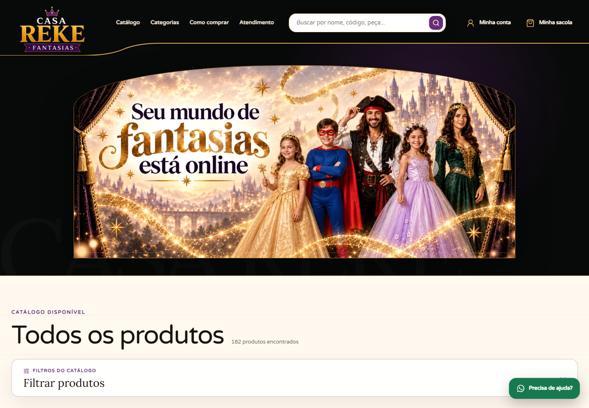
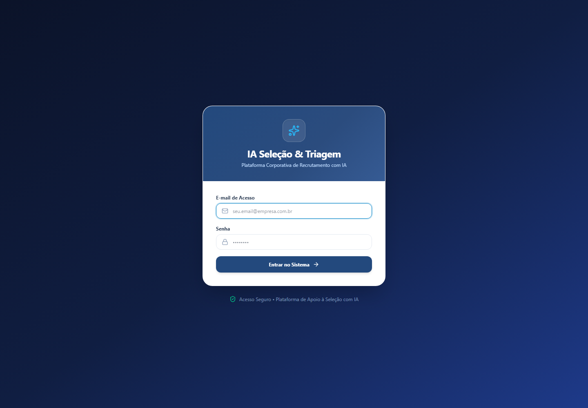

# Projetos

Alguns dos projetos em que trabalho têm código privado. Esta página reúne imagens, contexto e links para conhecer o que foi construído.

## Estocador

Gestão de estoque, consignação, vendas e repasses para brechós e lojas. O trabalho envolve ligar a entrada da peça à venda e ao acerto com o fornecedor, mantendo os dados de cada estabelecimento separados.

TypeScript, React, Next.js, Prisma e SQLite.

Captura da página pública, incluindo a demonstração com dados fictícios que o próprio site oferece.

[Visitar o Estocador](https://estocador.clasure.com.br)

## barberIA

Sistema de gestão e agendamento para barbearias. Reúne agenda, serviços, profissionais, clientes, comandas e financeiro. Entre os cuidados de implementação estão os conflitos de horário, as permissões da equipe e a separação entre estabelecimentos.

Node.js, Express, EJS e SQLite.

A página pública mostra capturas do sistema com dados de demonstração.

[Visitar o barberIA](https://barberia.clasure.com.br)

## HEYO

Loja de roupas oversized e fitness integrada ao Estocador. O sistema de estoque fornece produtos, fotos e disponibilidade; a loja organiza a apresentação das peças, as contas de clientes e os pedidos.

JavaScript, TypeScript, Node.js e SQLite.

[Visitar a HEYO](https://useheyo.com.br)

## Auto Bellini Veículos

Site institucional e vitrine de veículos, com painel administrativo e integração com o Shopcar. A manutenção inclui a apresentação do estoque, atualização das informações e publicação na hospedagem PHP.

React, TypeScript, Vite, PHP e SQLite.

[Visitar a Auto Bellini](https://autobelliniveiculos.com.br)

## Casa Reke Fantasias

Vitrine e loja online ligada ao catálogo do Estocador. O projeto reúne busca, seleção de peças, contas de clientes, pedidos e integração de pagamentos. Preço e disponibilidade são conferidos no servidor.

TypeScript, React, Next.js, Vinext, Drizzle e SQLite.

[Visitar a Casa Reke](https://fantasias.clasure.com.br)

## IA Seleção

Aplicação interna de apoio ao recrutamento. Importa vagas e candidatos, organiza requisitos e apresenta análises para a equipe. A triagem combina regras locais com revisão por modelos externos, mantendo a avaliação final com o recrutador.

Python, FastAPI, TypeScript, Next.js, SQLite e Docker.

Tela real de acesso, executada localmente. O projeto exige autorização; dados de candidatos, currículos e resultados de recrutamento não fazem parte desta apresentação pública.

## Sobre as imagens

Capturas feitas em novembro de 2026. As imagens dos sites foram obtidas em páginas públicas, sem acesso administrativo. As demonstrações não representam resultados comerciais nem dados de clientes. O código dos projetos apresentados aqui continua privado.

[Voltar ao perfil](README.md)
