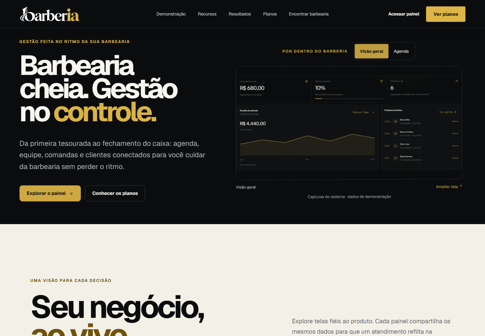
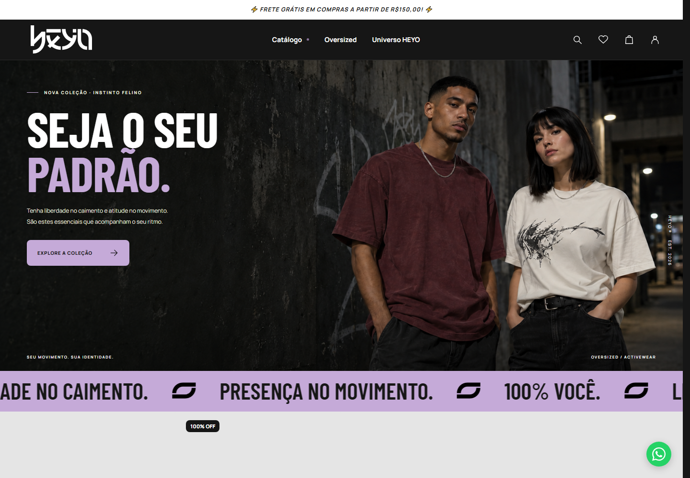

# Kadu Bellini

Estudo **Sistemas de Informação na UFMS**, trabalho com suporte na **Malti Sistemas** e também atuo na **Trainner RH**, em Campo Grande, MS.

Boa parte dos meus projetos começa com alguma coisa que vejo no dia a dia: uma rotina repetitiva, dados espalhados ou um sistema que poderia ser mais fácil de usar. Gosto de entender o processo, montar a solução e acompanhar o que acontece depois que ela entra em uso.

Trabalho com desenvolvimento web, integrações e automação. Também cuido da implantação e manutenção das aplicações em Linux.

[LinkedIn](https://www.linkedin.com/in/kadubxllini/) · [Clasure](https://clasure.com.br) · [Estocador](https://estocador.clasure.com.br)

[Ver imagens e apresentação dos projetos](PROJETOS.md)

| Estocador | barberIA | HEYO |
| --- | --- | --- |
|  |  |  |

## Projetos em que trabalho

### Estocador - gestão para brechós

Estoque, consignação, fornecedores, vendas no PDV e repasses. É um dos projetos em que mais trabalho a ligação entre as regras do negócio e a interface: da entrada de uma peça até a venda e o acerto com o fornecedor.

`TypeScript` · `React` · `Next.js` · `Prisma` · `SQLite`

[Acessar o Estocador](https://estocador.clasure.com.br) · Código privado

### IA Seleção - apoio ao recrutamento

Aplicação para trabalhar com vagas, currículos e requisitos, usando IA para apoiar a triagem. Tem processamento em segundo plano e acompanhamento do progresso das análises. A decisão final continua com o recrutador.

`Python` · `TypeScript` · `APIs` · `Docker`

[Ver o painel com dados fictícios](PROJETOS.md#ia-seleção) · Projeto de acesso restrito

### barberIA - gestão e agendamento

Sistema para barbearias com agenda, serviços, atendimento e gestão financeira. Trabalho em questões como evitar horários conflitantes, separar os dados de cada estabelecimento e manter compatibilidade com dados antigos.

`Node.js` · `Express` · `EJS` · `SQLite`

[Conhecer o barberIA](https://barberia.clasure.com.br) · Código privado

### HEYO - loja de roupas

Loja de roupas oversized e fitness integrada ao Estocador. O catálogo mantém a ligação entre cada peça, suas opções de cor e tamanho e o estoque de origem; a loja reúne vitrine, contas de clientes e pedidos.

`JavaScript` · `TypeScript` · `Node.js` · `SQLite`

[Visitar a HEYO](https://useheyo.com.br) · [Ver a apresentação](PROJETOS.md#heyo) · Código privado

### Auto Bellini Veículos - vitrine e estoque

Site de veículos com painel administrativo e integração com a API do Shopcar para trabalhar com o estoque da loja.

`React` · `TypeScript` · `PHP` · `SQLite`

[Ver a apresentação](https://www.linkedin.com/feed/update/urn:li:activity:7491292884399472640/)

## Outros trabalhos

Além dos sites, trabalho com **SQL, Firebird e relatórios em FastReport**, incluindo consultas, manutenção e migração de bases. O suporte me aproxima dos problemas que aparecem quando alguém realmente depende do sistema para trabalhar.

Também uso IA no desenvolvimento e monto fluxos com agentes para pesquisa, conteúdo e tarefas operacionais. Isso envolve integrar ferramentas, guardar o contexto necessário e conferir o resultado. Tenho trabalhado bastante com aprovações, recuperação de falhas e prevenção de ações duplicadas nesses fluxos.

Na infraestrutura, uso **Linux, SSH, Docker e systemd** para publicar aplicações, acompanhar logs e manter serviços e backups.

## Projetos com código público

| Projeto | Sobre |
| --- | --- |
| [VesteBem](https://github.com/gDABLIUolf/progweb-lojaonline) | E-commerce acadêmico feito em equipe, com Java, Spring Boot, Vue.js e PostgreSQL. |
| [Jarvis Acadêmico](https://github.com/kadubxllini/projeto_jarvis) | Assistente em Python para consultar PDFs com RAG e busca semântica, além de organizar tarefas e estudos. |
| [Banco Trainner / RADAR](https://github.com/kadubxllini/banco-trainner) | Aplicação em Python e Flask para propostas, relatórios e rotinas administrativas. |
| [Controle de Faltas](https://github.com/kadubxllini/presenca) | Aplicação com Node.js, Express e SQLite para acompanhar faltas nas disciplinas da faculdade. |

Os projetos misturam trabalho, estudo e ideias próprias. Alguns têm código privado; os públicos mostram outras partes do que venho aprendendo e construindo.

Se quiser conversar sobre algum deles ou sobre uma oportunidade, pode me chamar pelo [LinkedIn](https://www.linkedin.com/in/kadubxllini/).
